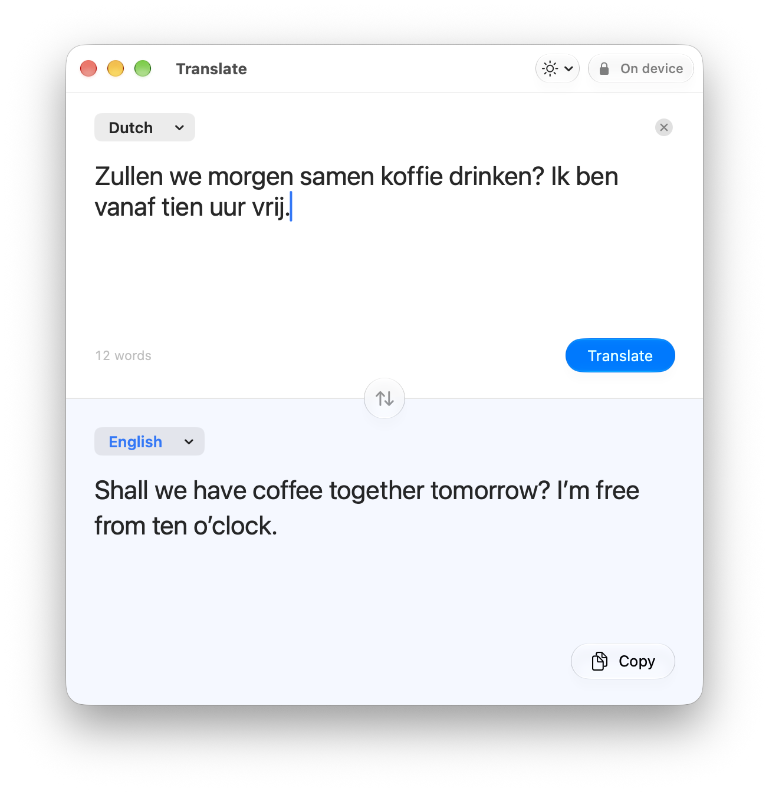

# Translate

A small native Mac window for translation between Dutch, English, and Turkish, using Apple's installed on-device models.

<p align="center">
  <picture>
    <source media="(prefers-color-scheme: dark)" srcset="docs/screenshot-dark.png">
    
  </picture>
</p>

## Works completely offline

Translation runs entirely on your Mac. The app is sandboxed with **no network access at all** — it cannot connect to the internet even if it wanted to — so your text never leaves the machine. There are no accounts, no telemetry, no cloud fallback, and no saved history.

The only step that needs a connection is the one-time download of language packs, which you do in System Settings, outside the app. After that, it works on a plane, offline, or with Wi‑Fi turned off.

## Download

Grab **Translate.zip** from the [latest release](https://github.com/merteminoglu/OnDeviceTranslate/releases/latest), unzip it and move `Translate.app` to `/Applications`. It's a universal build for Apple Silicon and Intel, and needs macOS 26 or later.

Translate isn't notarized by Apple, so macOS blocks the first launch. To allow it, open **System Settings → Privacy & Security** and click **Open Anyway**. Or run:

```sh
xattr -dr com.apple.quarantine /Applications/Translate.app
```

Then install the language packs (see [Language packs](#language-packs)).

## Requirements

- macOS 26 or later.
- The selected languages’ translation packs installed on the Mac (Dutch, English, and Turkish are supported).
- Xcode 26 or later to build (Swift 6).

## Build and open

```sh
Scripts/build.sh                  # release by default; CONFIG=debug to override, UNIVERSAL=1 for arm64 + x86_64
Scripts/run.sh                    # build, quit the running copy, relaunch
Scripts/install.sh                # build and swap into /Applications
```

The build creates an ad hoc signed development app in `build/Translate.app` (the whole `build/` folder is disposable). No dependencies are downloaded. Open `Package.swift` in Xcode to edit or debug the sources. For the sandboxed app, use the build script: running the Swift package executable directly from Xcode does not apply the bundle's sandbox entitlements.

## Language packs

In **System Settings → General → Language & Region → Translation Languages**, download the languages you want to use: Dutch, English, and Turkish. Apple requires internet access for that setup step outside the app. Return to Translate and click **Check Again** (or **Open System Settings** from the setup screen). Packs are shared with other apps on the Mac.

Translate itself uses `TranslationSession(installedSource:target:)`, which cannot request language downloads. Its App Sandbox entitlements grant no incoming or outgoing network access. There are no accounts, telemetry, cloud fallback, or saved translation history; text stays in memory until the window closes. Copy writes text to the normal macOS clipboard, which is managed by the system and other clipboard apps.

## Use

Choose the source and target languages from the menus beside their labels. Any two different languages among Dutch, English, and Turkish can be selected. Type or paste into the top field; translation starts automatically after you pause for half a second. Changing languages or swapping also translates automatically once the selected packs are checked. The **Translate** button and **Command Return** start translation immediately. Editing or clearing cancels pending work and discards outdated results. Copy the result with the button or **Shift Command C**. The center button swaps the selected languages (**Shift Command S**), using a successful translation as the new source. **Command K** clears both fields. The window follows the system's light or dark appearance by default; choose **Light** or **Dark** from the appearance button in the toolbar or **View → Appearance** to override it. The choice is remembered between launches. The source editor supports normal selection, multiline text, undo, and paste; translated text is selectable.

## Tests

```sh
swift test
```

Tests cover automatic translation after a typing pause, cancellation, manual translation without duplicate requests, automatic language changes and swaps, all six language directions, Turkish characters, request races, failed translations, removed/missing packs, empty input, clear, and multiline text. They use a controlled service because Apple's actual models depend on each Mac's installed language packs. A successful test run does not prove real engine availability or native keyboard behavior; those require testing the packaged app.

Apple references: [installed-language sessions](https://developer.apple.com/documentation/translation/translationsession/init(installedsource:target:)), [language availability](https://developer.apple.com/documentation/translation/languageavailability/status), [download languages on Mac](https://support.apple.com/guide/mac-help/translate-text-mchldd8b3c15/mac).

## Native UI check without language packs

```sh
Scripts/preview.sh                # builds and opens build/Translate UI Preview.app
```

This separate test-only app uses the production views and core with a controlled service. Its only translations are `Hallo.\nHoe gaat het?` ↔ `Hello.\nHow are you?` (with actual line breaks). It checks editing, undo, keyboard commands, clear, swap, and copy; it does not test Apple's engine. The fixture is excluded from `Translate.app`.

## License

[MIT](LICENSE)
